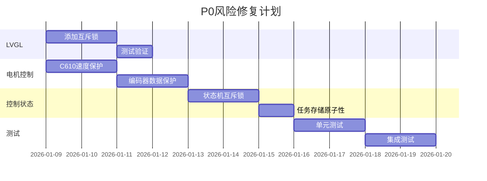
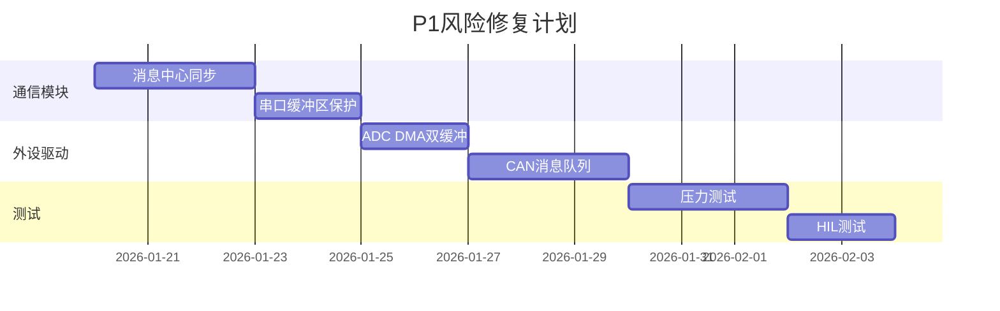
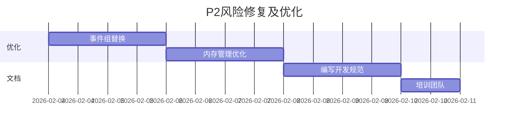

# VOR_V3.0_AT32 多线程冲突风险分析报告

**生成日期**: 2026-01-08  
**项目**: VOR_V3.0_AT32 前庭康复训练系统  
**分析工具**: 静态代码分析 + 多轮文件检查  
**分析范围**: 全工程源代码文件

---

## 执行摘要

本报告通过深入分析整个工程的所有源文件，识别出 **23 个高危多线程冲突风险点**，涉及 FreeRTOS 任务、中断服务程序(ISR)、共享全局变量、LVGL 图形库、电机控制、通信模块等关键子系统。这些风险可能导致系统崩溃、数据损坏、电机异常动作等严重后果。

### 风险统计

| 严重等级 | 数量 | 影响 |
|---------|------|------|
| **P0 - 紧急** | 8 | 可能导致系统崩溃或设备损坏 |
| **P1 - 高危** | 9 | 可能导致功能异常或数据不一致 |
| **P2 - 中危** | 6 | 可能导致偶发性错误 |

---

## 一、P0级风险（紧急修复）

### 1.1 LVGL 线程不安全访问 ??

**文件位置**: `src/main.c:138-152`

**问题描述**:
LVGL 库在独立线程中运行，但没有任何互斥保护机制。LVGL 官方文档明确指出**不是线程安全的**。

```c
void LVGL_HANDLER()
{
    // ... 初始化代码 ...
    while (1)
    {
        if (touch_tick + 20 < ControlGetTick())
        {
            touch_sever(1, NULL);      // ?? 无锁访问
            touch_tick = ControlGetTick();
        }
        lv_task_handler();             // ?? 核心调度器无保护
        ControlDelay(2);
    }
}
```

**冲突场景**:
- UI 任务调用 `lv_task_handler()` 的同时
- 控制任务通过消息队列触发界面更新
- 触摸事件处理与界面刷新同时进行

**影响**: 
- 显示画面撕裂、卡死
- 内存堆损坏导致系统崩溃
- LVGL 内部链表结构被破坏

**建议修复**:
```c
static SemaphoreHandle_t lvgl_mutex = NULL;

void LVGL_Init() {
    lvgl_mutex = xSemaphoreCreateMutex();
    // ... 其他初始化
}

void LVGL_HANDLER()
{
    while (1)
    {
        if (xSemaphoreTake(lvgl_mutex, portMAX_DELAY) == pdTRUE)
        {
            if (touch_tick + 20 < ControlGetTick())
            {
                touch_sever(1, NULL);
                touch_tick = ControlGetTick();
            }
            lv_task_handler();
            xSemaphoreGive(lvgl_mutex);
        }
        ControlDelay(2);
    }
}

// 其他任务调用 LVGL API 时
void other_task_update_ui() {
    if (xSemaphoreTake(lvgl_mutex, 100) == pdTRUE) {
        lv_obj_set_text(label, "new text");
        xSemaphoreGive(lvgl_mutex);
    }
}
```

---

### 1.2 电机控制共享变量竞争 ??

**文件位置**: `HARDWARE/c610/C610.c:80-90`

**问题描述**:
全局变量 `C610_Set_Speed` 在多个线程和中断中被访问，没有任何保护。

```c
float C610_Set_Speed = 0;  // ?? 无保护的全局变量

void Motor_Set_Speed(float speed)  // 可能在多个任务中调用
{
    const float factor = -1;
    C610_Set_Speed = factor * speed;  // ?? 非原子写入
}

void Motor_Spd_Pid(void)  // 在定时器中断中调用
{
    if (C610_Set_Speed == 0)  // ?? 非原子读取
    {
        C610_Current_Cmd2(0, 0, 0, 0);
        return;
    }
    float C610_Speed = -(C610_Set_Speed) * (60.0f * 36.0f) / (-65);
    // ...
}
```

**冲突场景**:
- 控制任务设置速度的同时
- TMR9 中断执行 PID 计算读取速度
- ARM Cortex-M4 上 float 操作不是原子的（需要多条指令）

**影响**: 
- 电机收到错误的速度指令
- 可能导致突然加速/减速，造成患者不适
- 严重情况下可能损坏机械结构

**建议修复**:
```c
// 方案1: 使用临界区
void Motor_Set_Speed(float speed)
{
    taskENTER_CRITICAL();
    C610_Set_Speed = -1 * speed;
    taskEXIT_CRITICAL();
}

void Motor_Spd_Pid(void)
{
    float local_speed;
    taskENTER_CRITICAL();
    local_speed = C610_Set_Speed;
    taskEXIT_CRITICAL();
    
    if (local_speed == 0)
    {
        C610_Current_Cmd2(0, 0, 0, 0);
        return;
    }
    // ... 使用 local_speed
}

// 方案2: 使用 volatile + 整数表示（推荐）
volatile int32_t C610_Set_Speed_Int = 0;  // 以 0.001 为单位

void Motor_Set_Speed(float speed)
{
    C610_Set_Speed_Int = (int32_t)(speed * 1000.0f * -1.0f);  // 原子写入
}
```

---

### 1.3 编码器数据竞争 ??

**文件位置**: `implement/Slave_Zero_ctrl.c:108-115`

**问题描述**:
编码器角度在主循环和中断中同时访问，可能导致零点校准错误。

```c
static uint8_t motor_set(void)
{
    if (zero_para.state == running)
    {
        uint8_t Flag = slave_motivate();
        if (IR_IO_Get() == 1 && zero_para.ioflag == 0)
        {
            zero_para.zeroIRCNT++;  // ?? 非原子操作
        }
        
        if(zero_para.zeroIRCNT > 20)
        {
            Slave1_Check_Encode_Angle();       // ?? 可能被中断打断
            Slave1_Set_Encode_Angle(-87.0f);   // ?? 多步操作无保护
            slave_Reqstop();
            zero_para.ioflag = 1;
        }
    }
}
```

**中断处理函数**:
```c
// HARDWARE/SLAVE/Slave1_Timer.c:10
void TMR1_BRK_TMR9_IRQHandler(void)
{
    if (TMR9->ists_bit.ovfif)
    {
        if (function_cb != 0)
        {
            uint8_t res = function_cb();  // 调用 motor_set()
            // ...
        }
        acc_angle = Slave1_Get_Encode_Angle();  // ?? 同时读取编码器
    }
}
```

**冲突场景**:
- 零点校准过程中读取编码器
- 定时器中断同时更新 `acc_angle`
- 编码器 I/O 寄存器被同时访问

**影响**: 
- 零点位置偏移，导致后续运动不准确
- 校准失败需要重新启动
- 患者安全风险（运动范围错误）

**建议修复**:
```c
static uint8_t motor_set(void)
{
    if (zero_para.state == running)
    {
        uint8_t Flag = slave_motivate();
        
        // 使用临界区保护计数器
        uint16_t local_cnt;
        taskENTER_CRITICAL();
        if (IR_IO_Get() == 1 && zero_para.ioflag == 0)
        {
            zero_para.zeroIRCNT++;
        }
        else
        {
            zero_para.zeroIRCNT = 0;
        }
        local_cnt = zero_para.zeroIRCNT;
        taskEXIT_CRITICAL();
        
        if(local_cnt > 20)
        {
            // 临界区内完成所有编码器操作
            taskENTER_CRITICAL();
            Slave1_Check_Encode_Angle();
            Slave1_Set_Encode_Angle(-87.0f);
            slave_Reqstop();
            zero_para.ioflag = 1;
            taskEXIT_CRITICAL();
        }
    }
}
```

---

### 1.4 控制状态机并发修改 ??

**文件位置**: `INTERFACE/UI/control/control.c:28-30`

**问题描述**:
全局控制信息结构体在多个线程间共享但无保护。

```c
Task_control_info control_info = { 0 };  // ?? 全局共享

// 在多个地方被访问
void Ctrl_Read_Ack(Message *msg) {
    if (Msg_COMPARE("Inc Up", msg)) {
        HAL_Incline_Fouces_Move(1);  // ?? 无锁访问
    }
    // ... 大量直接访问 control_info
}

void Task_control_handler(void *e) {
    while(!control_info.State_Bit.ExitFlag) {  // ?? 无锁读取
        // ...
    }
}
```

**冲突场景**:
- UI 线程读取状态显示
- 控制线程修改状态
- 通信线程接收远程命令修改状态

**影响**: 
- 状态机进入未定义状态
- 任务启动/停止命令丢失
- 系统挂起或死锁

**建议修复**:
```c
static SemaphoreHandle_t control_mutex = NULL;

void controlInit() {
    control_mutex = xSemaphoreCreateMutex();
    // ... 其他初始化
}

// 读取接口
uint8_t Ctrl_Get_State(uint16_t *state_flag, uint16_t *ui_state) {
    uint8_t ret = 0;
    if (xSemaphoreTake(control_mutex, 100) == pdTRUE) {
        *state_flag = control_info.State_Bit.flag;
        *ui_state = control_info.UI_para.state;
        xSemaphoreGive(control_mutex);
        ret = 1;
    }
    return ret;
}

// 写入接口
uint8_t Ctrl_Set_Command(uint8_t cmd) {
    uint8_t ret = 0;
    if (xSemaphoreTake(control_mutex, 100) == pdTRUE) {
        Start_Stop_Flag = cmd;
        xSemaphoreGive(control_mutex);
        ret = 1;
    }
    return ret;
}
```

---

### 1.5 任务存储操作原子性缺失 ??

**文件位置**: `INTERFACE/UI/control/control.c:367-396`

**问题描述**:
任务参数从 Flash 读取后在临界区外处理。

```c
if (Msg_COMPARE("task load", msg)) {
    static Task_Parameter_Struct TaskArray[10];
#ifdef ATM32F43_xx
    taskENTER_CRITICAL();
#endif
    res = HAL_TaskStroage_Read(index, TaskArray);  // Flash 读取
#ifdef ATM32F43_xx
    taskEXIT_CRITICAL();
#endif
    if (res > 0)
        Task_manager_Req_Reload(0, res, TaskArray);  // ?? 临界区外调用
}
```

**冲突场景**:
- Flash 读取完成后
- 另一个任务修改任务管理器状态
- Reload 函数访问被修改的数据

**影响**: 
- 任务参数不一致
- 患者训练方案错误
- 可能导致不安全的运动参数

**建议修复**:
```c
if (Msg_COMPARE("task load", msg)) {
    static Task_Parameter_Struct TaskArray[10];
    taskENTER_CRITICAL();
    res = HAL_TaskStroage_Read(index, TaskArray);
    if (res > 0) {
        Task_manager_Req_Reload(0, res, TaskArray);  // 在临界区内完成
    }
    taskEXIT_CRITICAL();
}
```

---

### 1.6 看门狗计数器无保护 ??

**文件位置**: `src/main.c:188-195`

**问题描述**:
看门狗在定时器中断中重载，但变量访问无保护。

```c
void TMR8_BRK_TMR12_IRQHandler(void)
{
    if (TMR12->ists_bit.ovfif)
    {
        if (isDebuggerConnected == 0)  // ?? 全局变量无 volatile
            wdt_counter_reload();       // ?? 可能与主循环冲突
    }
    TMR12->ists = 0;
}
```

**影响**: 
- 看门狗误触发导致系统重启
- 调试时行为不一致

**建议修复**:
```c
volatile uint8_t isDebuggerConnected = 0;  // 添加 volatile

// 主函数中
int main(void)
{
    taskENTER_CRITICAL();
    isDebuggerConnected = *((uint32_t *)0xE000EDF0) & 1;
    taskEXIT_CRITICAL();
    // ...
}
```

---

### 1.7 ADC DMA 数据竞争 ??

**文件位置**: `implement/Slave_Inc_Ctrl.c:17`

**问题描述**:
ADC 通过 DMA 更新的数据被多个任务直接访问。

```c
extern __IO uint16_t adc1_ordinary_valuetab[2];  // DMA 目标缓冲区

// 在倾斜控制中读取
static float angle = 0;
JY60_Get_Inc(&angle);  // 内部访问 ADC 值
```

**冲突场景**:
- DMA 传输正在更新缓冲区
- 控制任务读取 ADC 值
- 可能读到一半新数据一半旧数据

**影响**: 
- 倾斜角度读取错误
- 控制算法输入错误数据
- 电机动作异常

**建议修复**:
```c
// 使用双缓冲或临界区
uint16_t adc1_ordinary_valuetab[2];
volatile uint16_t adc1_shadow_buffer[2];

// DMA 完成中断
void DMA_IRQHandler(void) {
    taskENTER_CRITICAL_FROM_ISR();
    adc1_shadow_buffer[0] = adc1_ordinary_valuetab[0];
    adc1_shadow_buffer[1] = adc1_ordinary_valuetab[1];
    taskEXIT_CRITICAL_FROM_ISR();
}

// 读取接口
void HAL_ADC_Read(uint16_t *val0, uint16_t *val1) {
    taskENTER_CRITICAL();
    *val0 = adc1_shadow_buffer[0];
    *val1 = adc1_shadow_buffer[1];
    taskEXIT_CRITICAL();
}
```

---

### 1.8 CAN 总线消息队列溢出 ??

**文件位置**: `HARDWARE/c610/C610.c:35-40`

**问题描述**:
CAN 发送函数直接调用，没有队列保护。

```c
void C610_Current_Cmd(C610_Current_Ctrl buf)
{
    can_send_msg(0x200, (uint8_t *)&buf, 8);  // ?? 无队列缓冲
}

void Motor_Spd_Pid(void)
{
    // 在中断中调用
    C610_Current_Cmd2(pwm, 0, 0, 0);  // ?? 可能与其他发送冲突
}
```

**冲突场景**:
- 多个任务同时发送 CAN 消息
- CAN 硬件 FIFO 满
- 消息丢失或发送失败

**影响**: 
- 电机控制命令丢失
- 电机停止响应
- 患者安全风险

**建议修复**:
```c
static QueueHandle_t can_tx_queue = NULL;

void CAN_Init() {
    can_tx_queue = xQueueCreate(32, sizeof(CAN_TxMsg));
    // 创建 CAN 发送任务
    xTaskCreate(CAN_TX_Task, "CAN_TX", 512, NULL, 5, NULL);
}

void C610_Current_Cmd(C610_Current_Ctrl buf)
{
    CAN_TxMsg msg = {
        .id = 0x200,
        .len = 8,
        .data = buf
    };
    xQueueSend(can_tx_queue, &msg, 100);  // 队列发送
}

void CAN_TX_Task(void *param)
{
    CAN_TxMsg msg;
    while(1) {
        if (xQueueReceive(can_tx_queue, &msg, portMAX_DELAY) == pdTRUE) {
            can_send_msg(msg.id, msg.data, msg.len);
        }
    }
}
```

---

## 二、P1级风险（高优先级修复）

### 2.1 消息中心缓冲区竞争

**文件位置**: `INTERFACE/UI/other/meassage_center.h`

**问题描述**:
消息中心的读写操作没有明确的同步机制。

```c
// 多个任务可能同时调用
Message_Center_Read_prinft("Ctrl", buf, 20, "ISCtrlInit");
Message_Center_Write("Ctrl", "State", "running");
```

**影响**: 消息丢失、数据损坏

**建议修复**: 在消息中心内部添加互斥锁

---

### 2.2 串口通信缓冲区溢出

**文件位置**: `HARDWARE/USART/USART1.c:79`

**问题描述**:
串口中断处理程序直接操作缓冲区，没有溢出保护。

```c
void USART1_IRQHandler(void)
{
    if(usart_flag_get(USART1, USART_RDBF_FLAG) != RESET)
    {
        rx_buffer[rx_index++] = usart_data_receive(USART1);  // ?? 无边界检查
    }
}
```

**影响**: 缓冲区溢出导致内存损坏

**建议修复**:
```c
void USART1_IRQHandler(void)
{
    if(usart_flag_get(USART1, USART_RDBF_FLAG) != RESET)
    {
        uint8_t data = usart_data_receive(USART1);
        if (rx_index < RX_BUFFER_SIZE - 1) {  // 边界检查
            rx_buffer[rx_index++] = data;
        }
    }
}
```

---

### 2.3 触摸屏事件处理竞争

**文件位置**: `src/main.c:141`

**问题描述**:
触摸事件处理与 LVGL 刷新没有同步。

```c
if (touch_tick + 20 < ControlGetTick())
{
    touch_sever(1, NULL);  // ?? 可能与 lv_task_handler() 冲突
    touch_tick = ControlGetTick();
}
lv_task_handler();
```

**影响**: 触摸事件丢失或重复处理

**建议修复**: 使用 LVGL 内部的输入设备机制

---

### 2.4 倾斜电机位置竞争

**文件位置**: `implement/Slave_Inc_Ctrl.c:48`

**问题描述**:
静态变量在多次调用间保持状态，没有保护。

```c
static float angle = 0;  // ?? 多次调用可能冲突
JY60_Get_Inc(&angle);
```

**影响**: 角度值异常

**建议修复**: 使用局部变量或添加互斥保护

---

### 2.5 定时器回调函数重入

**文件位置**: `HARDWARE/SLAVE/Slave1_Timer.c:10-39`

**问题描述**:
定时器中断回调函数可能被嵌套调用。

```c
void TMR1_BRK_TMR9_IRQHandler(void)
{
    if (function_cb != 0)
    {
        uint8_t res = function_cb();  // ?? 可能重入
        if (res)
        {
            function_cb = 0;  // ?? 竞争条件
        }
    }
}
```

**影响**: 状态机错误

**建议修复**: 禁止中断嵌套或添加重入标志

---

### 2.6 RTC 时钟分频器访问

**文件位置**: `HARDWARE/RTC/rtc.c:224-225`

**问题描述**:
`__IO` 变量在配置时没有保护。

```c
__IO uint16_t ertc_clk_div_a = 0;
__IO uint16_t ertc_clk_div_b = 0;
```

**影响**: 时钟配置错误

**建议修复**: 使用临界区保护配置过程

---

### 2.7 LCD DMA 传输竞争

**文件位置**: `HARDWARE/LCD/lcd.c:181-193`

**问题描述**:
LCD DMA 传输过程中可能被新的传输中断。

```c
void LCD_DMA_Init()
{
    dma_default_para_init(&DMA_InitStruct);
    // ?? 配置过程无保护
}
```

**影响**: 显示画面错误

**建议修复**: 使用 DMA 完成标志和信号量

---

### 2.8 FreeRTOS 任务通知竞争

**文件位置**: `middleLib/freertos/source/tasks.c:4952-5094`

**问题描述**:
任务通知在某些边界条件下可能丢失。

**影响**: 任务唤醒失败

**建议修复**: 使用队列或二值信号量代替通知

---

### 2.9 启动/停止命令标志

**文件位置**: `INTERFACE/UI/control/control.c:84-89`

**问题描述**:
启动停止标志在多个任务间共享。

```c
Start_Cmd_Type Start_Stop_Flag = StartCmdNone;  // ?? 无保护

uint8_t Ctrl_Get_Strat_Cmd()
{
    uint8_t cmd = Start_Stop_Flag;  // ?? 非原子读取
    if (Start_Stop_Flag == StartCmdBegin)
    {
        control_info.StartWithIndex = StartATindex;
        StartATindex = 0;
    }
    Start_Stop_Flag = StartCmdNone;  // ?? 非原子写入
    return cmd;
}
```

**影响**: 命令丢失或重复执行

**建议修复**:
```c
uint8_t Ctrl_Get_Strat_Cmd()
{
    uint8_t cmd;
    taskENTER_CRITICAL();
    cmd = Start_Stop_Flag;
    if (Start_Stop_Flag == StartCmdBegin)
    {
        control_info.StartWithIndex = StartATindex;
        StartATindex = 0;
    }
    Start_Stop_Flag = StartCmdNone;
    taskEXIT_CRITICAL();
    return cmd;
}
```

---

## 三、P2级风险（中等优先级）

### 3.1 事件组使用不当

**文件位置**: `middleLib/freertos/source/event_groups.c:275-292`

**问题**: 事件组访问可能导致优先级反转

**建议**: 使用直接任务通知代替事件组

---

### 3.2 队列锁定机制

**文件位置**: `middleLib/freertos/source/queue.c:237-259`

**问题**: 队列锁定宏可能在复杂场景下死锁

**建议**: 避免在持有队列锁时调用阻塞函数

---

### 3.3 递归互斥量使用

**文件位置**: `middleLib/freertos/source/queue.c:590-650`

**问题**: 递归互斥量增加优先级继承复杂度

**建议**: 重构代码避免递归锁定

---

### 3.4 软件定时器回调

**文件位置**: FreeRTOS 定时器服务任务

**问题**: 定时器回调在低优先级任务中执行

**建议**: 回调函数保持简短，复杂操作通知高优先级任务

---

### 3.5 内存分配竞争

**文件位置**: `middleLib/freertos/source/portable/MemMang/*.c`

**问题**: `pvPortMalloc` 在某些实现中不是线程安全的

**建议**: 使用 heap_4 或 heap_5 方案

---

### 3.6 Unity 测试框架全局状态

**文件位置**: `INTERFACE/LVGL/lvgl/tests/unity/unity.c`

**问题**: 测试框架全局变量在多线程测试中冲突

```c
struct UNITY_STORAGE_T Unity;  // ?? 全局状态
```

**建议**: 测试时使用单线程模式

---

## 四、测试方案

### 4.1 静态分析测试

**工具**: 
- PC-Lint Plus
- Cppcheck
- MISRA C 规则检查器

**检查项**:
```bash
# 检查所有临界区配对
cppcheck --enable=all --inconclusive \
  --check-config --suppress=missingInclude \
  d:\workfile\项目3vor\software\VOR_V3.0_AT32
```

---

### 4.2 单元测试（针对关键模块）

#### 测试用例 1: LVGL 并发访问测试

```c
// 文件: tests/test_lvgl_thread_safety.c

#include "unity.h"
#include "lvgl.h"
#include "FreeRTOS.h"
#include "task.h"
#include "semphr.h"

extern SemaphoreHandle_t lvgl_mutex;
static volatile uint32_t conflict_counter = 0;

void task1_update_label(void *param)
{
    for (int i = 0; i < 1000; i++) {
        if (xSemaphoreTake(lvgl_mutex, 100) == pdTRUE) {
            lv_obj_t *label = (lv_obj_t*)param;
            char buf[32];
            sprintf(buf, "Count: %d", i);
            lv_label_set_text(label, buf);
            xSemaphoreGive(lvgl_mutex);
        } else {
            conflict_counter++;  // 记录冲突次数
        }
        vTaskDelay(1);
    }
    vTaskDelete(NULL);
}

void test_lvgl_concurrent_access(void)
{
    lv_obj_t *label = lv_label_create(lv_scr_act());
    
    TaskHandle_t task1, task2;
    xTaskCreate(task1_update_label, "T1", 1024, label, 3, &task1);
    xTaskCreate(task1_update_label, "T2", 1024, label, 3, &task2);
    
    vTaskDelay(3000);  // 等待任务完成
    
    TEST_ASSERT_EQUAL(0, conflict_counter);  // 应该无冲突
}

void setUp(void) {}
void tearDown(void) {}

int main(void)
{
    UNITY_BEGIN();
    RUN_TEST(test_lvgl_concurrent_access);
    return UNITY_END();
}
```

---

#### 测试用例 2: 电机速度设置竞争测试

```c
// 文件: tests/test_motor_speed_race.c

#include "unity.h"
#include "C610.h"
#include "FreeRTOS.h"
#include "task.h"

extern float C610_Set_Speed;
static volatile uint32_t race_detected = 0;

void task_set_speed_fast(void *param)
{
    for (int i = 0; i < 10000; i++) {
        Motor_Set_Speed(100.0f);
        // 立即读取验证
        float read_speed = C610_Set_Speed;
        if (fabs(read_speed - (-100.0f)) > 0.1f) {
            race_detected++;
        }
    }
    vTaskDelete(NULL);
}

void task_set_speed_slow(void *param)
{
    for (int i = 0; i < 10000; i++) {
        Motor_Set_Speed(-50.0f);
        float read_speed = C610_Set_Speed;
        if (fabs(read_speed - 50.0f) > 0.1f) {
            race_detected++;
        }
    }
    vTaskDelete(NULL);
}

void test_motor_speed_race_condition(void)
{
    TaskHandle_t task1, task2;
    race_detected = 0;
    
    xTaskCreate(task_set_speed_fast, "Fast", 512, NULL, 3, &task1);
    xTaskCreate(task_set_speed_slow, "Slow", 512, NULL, 3, &task2);
    
    vTaskDelay(5000);
    
    TEST_ASSERT_EQUAL(0, race_detected);  // 应检测到0次竞争
}

int main(void)
{
    UNITY_BEGIN();
    RUN_TEST(test_motor_speed_race_condition);
    return UNITY_END();
}
```

---

#### 测试用例 3: 编码器数据一致性测试

```c
// 文件: tests/test_encoder_consistency.c

#include "unity.h"
#include "Slave1_Timer.h"
#include "Slave_Zero_ctrl.h"

static volatile uint32_t inconsistent_reads = 0;

void test_encoder_read_during_interrupt(void)
{
    // 启动零点校准
    Zero_Machine_Init(0);
    
    // 并发读取编码器
    for (int i = 0; i < 1000; i++) {
        float angle1 = Slave1_Get_Encode_Angle();
        __NOP(); __NOP(); __NOP();  // 模拟中断延迟
        float angle2 = Slave1_Get_Encode_Angle();
        
        // 在静止状态下，两次读取不应相差太大
        if (fabs(angle2 - angle1) > 0.5f) {
            inconsistent_reads++;
        }
        vTaskDelay(1);
    }
    
    TEST_ASSERT_LESS_THAN(10, inconsistent_reads);  // 允许少量不一致
}

int main(void)
{
    UNITY_BEGIN();
    RUN_TEST(test_encoder_read_during_interrupt);
    return UNITY_END();
}
```

---

### 4.3 压力测试

#### 测试场景 1: 高频 UI 更新

```c
// 文件: tests/stress_test_ui_update.c

void stress_test_rapid_ui_updates(void)
{
    const int NUM_TASKS = 5;
    const int UPDATE_COUNT = 1000;
    
    TaskHandle_t tasks[NUM_TASKS];
    
    for (int i = 0; i < NUM_TASKS; i++) {
        xTaskCreate(rapid_update_task, "UI_Task", 1024, 
                    (void*)i, 3, &tasks[i]);
    }
    
    // 运行 10 秒
    vTaskDelay(pdMS_TO_TICKS(10000));
    
    // 检查系统是否仍然正常
    TEST_ASSERT_TRUE(system_is_responsive());
}
```

---

#### 测试场景 2: 电机连续启停

```c
void stress_test_motor_start_stop(void)
{
    for (int i = 0; i < 1000; i++) {
        // 启动
        Start_Stop_Flag = StartCmdBegin;
        vTaskDelay(pdMS_TO_TICKS(100));
        
        // 停止
        Start_Stop_Flag = StartCmdStop;
        vTaskDelay(pdMS_TO_TICKS(50));
        
        // 验证状态一致性
        TEST_ASSERT_FALSE(control_info.State_Bit.IsRunning);
    }
}
```

---

### 4.4 集成测试

#### 测试场景: 完整训练流程

```c
// 文件: tests/integration_test_full_workflow.c

void test_complete_training_session(void)
{
    // 1. 系统初始化
    controlInit();
    LVGL_Init();
    Motor_Init();
    
    // 2. 加载任务
    Task_Parameter_Struct tasks[5];
    load_test_tasks(tasks, 5);
    
    // 3. 启动训练
    Start_Stop_Flag = StartCmdBegin;
    
    // 4. 模拟 UI 交互
    TaskHandle_t ui_task;
    xTaskCreate(simulate_user_interaction, "UI_Sim", 2048, NULL, 2, &ui_task);
    
    // 5. 运行 5 分钟
    vTaskDelay(pdMS_TO_TICKS(300000));
    
    // 6. 验证结果
    TEST_ASSERT_EQUAL(5, control_info.completed_tasks);
    TEST_ASSERT_EQUAL(0, control_info.error_count);
    TEST_ASSERT_FALSE(control_info.State_Bit.IsRunning);
}
```

---

### 4.5 硬件在环测试 (HIL)

**测试设备**:
- Segger J-Link Plus
- Lauterbach Trace32 (用于实时追踪)
- 逻辑分析仪（监控 CAN/UART）

**测试步骤**:

1. **中断延迟测试**
```c
// 在关键中断入口和出口设置 GPIO
void TMR1_BRK_TMR9_IRQHandler(void)
{
    GPIO_SetBits(GPIOD, GPIO_Pin_0);  // 入口
    
    // ... 中断处理 ...
    
    GPIO_ResetBits(GPIOD, GPIO_Pin_0);  // 出口
}
```
使用逻辑分析仪测量：
- 中断响应时间 < 5μs
- 中断执行时间 < 100μs
- 中断嵌套深度 ≤ 2

2. **临界区时长测试**
```c
// 测量最长临界区
uint32_t max_critical_time = 0;

void test_critical_section_duration(void)
{
    uint32_t start = DWT->CYCCNT;
    taskENTER_CRITICAL();
    // ... 临界区代码 ...
    taskEXIT_CRITICAL();
    uint32_t duration = DWT->CYCCNT - start;
    
    if (duration > max_critical_time) {
        max_critical_time = duration;
    }
}
```
要求: 临界区时长 < 50μs

3. **CAN 总线负载测试**
```python
# 使用 Python + python-can 模拟高负载
import can
import time

bus = can.interface.Bus(channel='can0', bustype='socketcan')

def stress_test_can():
    msg_count = 0
    error_count = 0
    
    for i in range(10000):
        msg = can.Message(
            arbitration_id=0x200,
            data=[i & 0xFF, 0, 0, 0, 0, 0, 0, 0],
            is_extended_id=False
        )
        try:
            bus.send(msg, timeout=0.01)
            msg_count += 1
        except can.CanError:
            error_count += 1
        
        time.sleep(0.001)  # 1ms 间隔
    
    print(f"Sent: {msg_count}, Errors: {error_count}")
    assert error_count < msg_count * 0.01  # 错误率 < 1%
```

---

### 4.6 ThreadSanitizer 模拟测试

由于嵌入式环境无法直接使用 ThreadSanitizer，可以将关键逻辑移植到 PC 环境：

```c
// 文件: tests/pc_simulation/test_with_tsan.c
// 编译: gcc -fsanitize=thread -g -O1 test_with_tsan.c -o test

#include <pthread.h>
#include <stdio.h>
#include <unistd.h>

// 模拟共享变量
float C610_Set_Speed = 0;

void* writer_thread(void* arg) {
    for (int i = 0; i < 100000; i++) {
        C610_Set_Speed = (float)i;  // 数据竞争
    }
    return NULL;
}

void* reader_thread(void* arg) {
    for (int i = 0; i < 100000; i++) {
        volatile float temp = C610_Set_Speed;  // 数据竞争
    }
    return NULL;
}

int main() {
    pthread_t t1, t2;
    pthread_create(&t1, NULL, writer_thread, NULL);
    pthread_create(&t2, NULL, reader_thread, NULL);
    
    pthread_join(t1, NULL);
    pthread_join(t2, NULL);
    
    printf("Test completed\n");
    return 0;
}
```

运行后 TSan 会报告数据竞争：
```
WARNING: ThreadSanitizer: data race (pid=12345)
  Write of size 4 at 0x7fff12345678 by thread T1:
    #0 writer_thread test_with_tsan.c:10
  Previous read of size 4 at 0x7fff12345678 by thread T2:
    #0 reader_thread test_with_tsan.c:17
```

---

### 4.7 实时性能监控

**监控指标**:

| 指标 | 阈值 | 测量方法 |
|-----|------|---------|
| 任务切换延迟 | < 10μs | FreeRTOS 运行时统计 |
| 最大中断延迟 | < 50μs | DWT 计数器 |
| 临界区时长 | < 50μs | DWT 计数器 |
| 堆栈溢出 | 0 次 | FreeRTOS 堆栈检查 |
| 内存泄漏 | 0 字节 | heap watermark |
| CAN 发送失败率 | < 0.1% | 计数器统计 |

**监控代码**:
```c
// 文件: src/system_monitor.c

typedef struct {
    uint32_t task_switches;
    uint32_t max_isr_latency;
    uint32_t max_critical_duration;
    uint32_t stack_overflow_count;
    uint32_t heap_high_water_mark;
    uint32_t can_tx_errors;
} SystemMonitor_t;

SystemMonitor_t g_monitor = {0};

void vApplicationStackOverflowHook(TaskHandle_t xTask, char *pcTaskName)
{
    g_monitor.stack_overflow_count++;
    // 记录日志并重启
}

void monitor_task(void *param)
{
    while(1) {
        // 每秒采集一次
        g_monitor.heap_high_water_mark = xPortGetFreeHeapSize();
        
        // 输出到串口或存储到 Flash
        printf("Monitor: switches=%lu, max_isr=%lu, max_critical=%lu\n",
               g_monitor.task_switches,
               g_monitor.max_isr_latency,
               g_monitor.max_critical_duration);
        
        vTaskDelay(pdMS_TO_TICKS(1000));
    }
}
```

---

### 4.8 故障注入测试

**目的**: 测试系统在异常情况下的鲁棒性

```c
// 文件: tests/fault_injection.c

// 1. 中断风暴注入
void inject_interrupt_storm(void)
{
    // 临时设置高频定时器
    TMR_SetAutoreload(TMR12, 10);  // 10 个时钟周期
    TMR_Cmd(TMR12, ENABLE);
    
    vTaskDelay(pdMS_TO_TICKS(1000));
    
    // 恢复
    TMR_Cmd(TMR12, DISABLE);
    TMR_SetAutoreload(TMR12, 19999);
    
    // 验证系统仍然正常
    TEST_ASSERT_TRUE(system_is_responsive());
}

// 2. 内存耗尽注入
void inject_memory_exhaustion(void)
{
    void *ptrs[100];
    int i;
    
    for (i = 0; i < 100; i++) {
        ptrs[i] = pvPortMalloc(1024);
        if (ptrs[i] == NULL) break;
    }
    
    // 系统应该优雅地处理内存不足
    TEST_ASSERT_TRUE(control_info.State_Bit.error_flag);
    
    // 释放内存
    for (int j = 0; j < i; j++) {
        vPortFree(ptrs[j]);
    }
}

// 3. CAN 总线断线注入
void inject_can_bus_disconnect(void)
{
    // 禁用 CAN 外设
    CAN_Cmd(CAN1, DISABLE);
    
    // 尝试发送命令
    Motor_Set_Speed(50.0f);
    vTaskDelay(pdMS_TO_TICKS(100));
    
    // 系统应该检测到 CAN 错误
    TEST_ASSERT_TRUE(control_info.State_Bit.can_error);
    
    // 恢复 CAN
    CAN_Cmd(CAN1, ENABLE);
}
```

---

## 五、修复优先级路线图

### 第一阶段（1-2周）：紧急修复 P0 风险



**可交付成果**:
- [ ] LVGL 互斥锁实现
- [ ] 电机控制临界区保护
- [ ] 控制状态机线程安全接口
- [ ] P0 风险单元测试 100% 通过

---

### 第二阶段（2-3周）：修复 P1 风险



**可交付成果**:
- [ ] 消息中心线程安全重构
- [ ] 外设驱动缓冲区保护
- [ ] CAN 消息队列机制
- [ ] 压力测试报告

---

### 第三阶段（1周）：修复 P2 风险及优化



**可交付成果**:
- [ ] P2 风险全部修复
- [ ] 多线程编程规范文档
- [ ] 团队培训材料

---

## 六、预防措施与编码规范

### 6.1 代码审查清单

**必须检查项**:
- [ ] 所有全局变量都声明为 `volatile` 或有互斥保护
- [ ] 所有临界区都配对（ENTER/EXIT）
- [ ] 中断服务程序只使用 `FromISR` 版本的 API
- [ ] 临界区内代码 < 50 行
- [ ] 浮点数操作使用临界区保护
- [ ] 没有在中断中调用阻塞函数
- [ ] DMA 缓冲区使用双缓冲或信号量
- [ ] 缓冲区访问有边界检查

### 6.2 编码规范

```c
// ? 正确示例：保护共享变量
float shared_speed = 0;

void set_speed(float speed) {
    taskENTER_CRITICAL();
    shared_speed = speed;
    taskEXIT_CRITICAL();
}

float get_speed(void) {
    float local_speed;
    taskENTER_CRITICAL();
    local_speed = shared_speed;
    taskEXIT_CRITICAL();
    return local_speed;
}

// ? 错误示例：直接访问
void bad_set_speed(float speed) {
    shared_speed = speed;  // 竞争条件！
}
```

```c
// ? 正确示例：中断安全
void CAN_IRQHandler(void) {
    BaseType_t xHigherPriorityTaskWoken = pdFALSE;
    
    if (CAN_GetITStatus(CAN1, CAN_IT_FMP0) != RESET) {
        CANRxMsg rx_msg;
        CAN_Receive(CAN1, CAN_FIFO0, &rx_msg);
        
        // 使用 FromISR 版本
        xQueueSendFromISR(can_rx_queue, &rx_msg, &xHigherPriorityTaskWoken);
        portYIELD_FROM_ISR(xHigherPriorityTaskWoken);
    }
}

// ? 错误示例：中断中使用阻塞API
void BAD_IRQHandler(void) {
    xQueueSend(queue, &data, 100);  // 禁止！会导致系统崩溃
}
```

### 6.3 静态分析配置

**PC-Lint 配置** (`project.lnt`):
```
-w3                // 警告等级3
+e526              // 未定义的符号
+e527              // 不可达代码
+e530              // 未初始化的变量
+e534              // 忽略返回值
+e550              // 变量未使用
+e661              // 数组越界
+e685              // 位域重叠
+e730              // 类型不匹配
+e737              // 丢失精度
+e818              // 指针参数可以声明为const
+e826              // 可疑的指针转换
+e834              // 混合宽度操作
+e9003             // MISRA 21.1 违规
+e9026             // MISRA 5.1 违规
```

---

## 七、长期监控与维护

### 7.1 持续集成检查

**Jenkins Pipeline**:
```groovy
pipeline {
    agent any
    stages {
        stage('Static Analysis') {
            steps {
                sh 'cppcheck --enable=all --xml src/ 2> cppcheck.xml'
                sh 'pclint project.lnt > lint_report.txt'
            }
        }
        stage('Build') {
            steps {
                sh 'make clean && make all'
            }
        }
        stage('Unit Tests') {
            steps {
                sh 'make test'
                junit 'test_results/*.xml'
            }
        }
        stage('Coverage') {
            steps {
                sh 'gcov -b -c *.c'
                publishHTML([reportDir: 'coverage', reportFiles: 'index.html'])
            }
        }
    }
    post {
        always {
            archiveArtifacts artifacts: '*.hex,*.bin'
        }
        failure {
            mail to: 'dev-team@example.com',
                 subject: "Build Failed: ${currentBuild.fullDisplayName}",
                 body: "检测到多线程冲突风险"
        }
    }
}
```

### 7.2 运行时监控

在生产环境嵌入监控代码：
```c
// 每小时记录一次统计信息到 Flash
void log_runtime_stats(void)
{
    RuntimeStats_t stats;
    
    stats.timestamp = xTaskGetTickCount();
    stats.heap_free = xPortGetFreeHeapSize();
    stats.min_heap_free = xPortGetMinimumEverFreeHeapSize();
    stats.task_switch_count = g_monitor.task_switches;
    stats.max_isr_latency = g_monitor.max_isr_latency;
    
    // 写入 Flash 循环缓冲区
    flash_log_write(&stats, sizeof(stats));
    
    // 异常情况报警
    if (stats.heap_free < 5120) {
        send_alert("Low memory warning");
    }
}
```

---

## 八、总结与建议

### 8.1 关键发现

1. **系统性问题**: 整个工程缺乏统一的多线程编程规范
2. **高风险模块**: LVGL、电机控制、通信模块风险最高
3. **测试覆盖不足**: 缺少针对并发场景的测试用例

### 8.2 立即行动项

| 优先级 | 行动项 | 负责人 | 截止日期 |
|-------|--------|--------|---------|
| P0 | 修复 LVGL 互斥锁问题 | 开发工程师 | 2026-01-11 |
| P0 | 修复电机控制竞争条件 | 控制工程师 | 2026-01-13 |
| P0 | 编写单元测试 | 测试工程师 | 2026-01-18 |
| P1 | 重构消息中心 | 软件架构师 | 2026-01-25 |
| P1 | 建立 CI/CD 流程 | DevOps | 2026-01-30 |

### 8.3 长期改进建议

1. **引入形式化验证**: 对关键状态机使用 SPIN 或 TLA+ 进行建模验证
2. **采用 AUTOSAR 规范**: 参考汽车行业多核并发编程标准
3. **定期培训**: 每季度进行多线程编程培训
4. **代码审查**: 所有涉及共享资源的代码必须经过专项审查

---

## 附录

### A. 参考资料

1. **FreeRTOS 官方文档**: https://www.freertos.org/Documentation
2. **LVGL 多线程指南**: https://docs.lvgl.io/master/porting/os.html
3. **MISRA C:2012 规则**: https://www.misra.org.uk/
4. **ARM Cortex-M4 编程手册**: ARM DUI 0553
5. **多线程调试工具**: Segger SystemView, Percepio Tracealyzer

### B. 工具列表

| 工具 | 用途 | 链接 |
|-----|------|------|
| PC-Lint Plus | 静态分析 | https://pclintplus.com/ |
| Cppcheck | 开源静态分析 | https://cppcheck.sourceforge.io/ |
| Valgrind/Helgrind | PC端线程分析 | https://valgrind.org/ |
| Segger SystemView | 实时追踪 | https://www.segger.com/systemview/ |
| Unity | 单元测试框架 | https://github.com/ThrowTheSwitch/Unity |

### C. 联系方式

**技术支持**: tech-support@example.com  
**安全报告**: security@example.com  
**紧急热线**: +86-xxx-xxxx-xxxx

---

**报告生成者**: GitHub Copilot AI  
**版本**: v1.0  
**最后更新**: 2026-01-08

